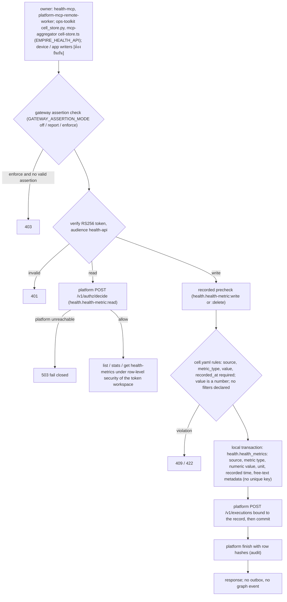

# 01 — Business process (As-Is / To-Be)

life-health-api คือ cell ที่เก็บค่าตรวจวัดสุขภาพของ owner เป็น log ตามเวลา: แหล่งที่มา ชนิด metric ค่าตัวเลข หน่วย และเวลาที่วัด ผู้เรียกคือ owner ผ่าน `health-mcp`, hosted tool hub และ owner tooling ด้วย token ของ `empire-platform`; ไม่มีหน้าเว็บใดอ่าน cell นี้ และไม่ส่ง graph event

Last reviewed: 2026-11-27 · commit `dd4bafe`

## As-Is (จากโค้ดวันนี้)

Sources: `cell.yaml`, `migrations/0001_health.sql`, `pyproject.toml` (pinned `platform-cellkit` 1.0.11: `cellkit/app.py` `allow`, `write`, `emit`, erase route; `cellkit/server.py` gateway install; `cellkit/spec.py` `audience`), `README.md`, `PRODUCT.md` §Users

ข้อเท็จจริงสำคัญจากโค้ด:

- resource เดียว `/v1/health-metrics` ไม่มี filter: list รับเฉพาะ paging, `id`, `legacy_id`, `updated_since`, `null`; `stats` ปฏิเสธทุก `group_by` (422); มี get, get-by-legacy-id, create (`Idempotency-Key`), patch (`expected_version`), delete และ `POST /v1/health-metrics/erase` (ลบทั้ง workspace ของผู้เรียก, ต้องมี `health.health-metric:delete` และยืนยัน workspace id ของตัวเอง)
- ข้อมูลเป็นข้อมูลสุขภาพส่วนตัว: ไฟล์นี้บอกเฉพาะชนิดข้อมูล ไม่มีตัวอย่างค่า
- ไม่มี `graph:` ใน `cell.yaml` จึงไม่เขียน outbox และไม่มี service publisher; การเขียนทุกครั้งมีเฉพาะ execution และ audit (row hashes) ที่ platform
- ใครเขียนค่าเข้ามาจริง (อุปกรณ์หรือแอป) ไม่มีในโค้ดของ repo นี้ [ต้องยืนยัน]
- `GATEWAY_ASSERTION_MODE` ค่าเริ่มต้น `off`; ค่าที่ใช้ใน production [ต้องยืนยัน]

## To-Be

ไม่มี To-Be ที่เขียนไว้

## Gap

| ID | As-Is → To-Be | Status | Owner | Evidence |
|---|---|---|---|---|
| G1 | ไม่มี To-Be ที่เขียนไว้ (PRODUCT.md มีแค่ตัววัดที่เสนอโดยไม่มีเป้า, specs เป็นงาน baseline / test) → owner กำหนด To-Be ของ cell นี้ | decide | owner | `PRODUCT.md` §Measures ("Proposed (nothing collects them yet)"); `specs/001-l2-baseline/spec.md`, `specs/002-cellkit-test-depth/spec.md` |
| G2 | ตัววัดที่เสนอ "readings per `metric_type` per month" ต้องมี filter `metric_type` แต่ `cell.yaml` ไม่ประกาศ filter → owner ตัดสินว่าจะเพิ่มหรือไม่ | decide | owner | `PRODUCT.md` §Measures; `cell.yaml` `filters: []` |

## Open questions

- `GATEWAY_ASSERTION_MODE` ใน production เป็น `report` หรือ `enforce` [ต้องยืนยัน]
